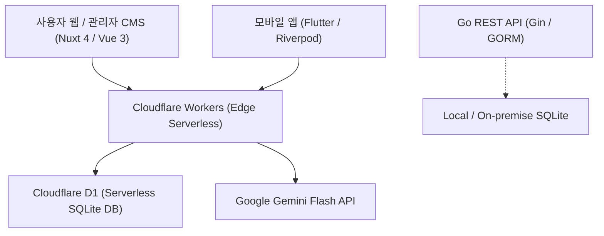

# 체크인데일리 (Check-in Daily) ✈️🏨

> **대한민국 대표 여행 전문 미디어 플랫폼**  
> 전 세계 항공·호텔·여행지·여행업계 심층 뉴스와 실시간 여행 정보를 다국어로 제공합니다.

---

## 📌 서비스 개요 (Service Overview)

**체크인데일리(Check-in Daily)**는 여행 일기나 예약 플랫폼이 아닌, **실제 상용 운영 기준의 여행 전문 뉴스·미디어 플랫폼**입니다.

* **주요 카테고리**: 항공(Flights), 호텔(Hotels), 여행지(Destinations), 업계 동향(Industry), 실시간 속보(Breaking News)
* **다국어 지원**: 한국어(KO), 영어(EN), 일본어(JA), 중국어 번체(ZH-TW), 베트남어(VI), 태국어(TH), 스페인어(ES) 7개 언어 지원
* **고도화 기능**:
  * 관리자 키워드 기반 AI 뉴스 자동 생성기 (300자 ~ 1,000자 검증 규칙 준수)
  * 기사 발행 규칙 엄격 검증기 (본문 800~2,000자, 본문 이미지 4~10장)
  * 환율 실시간 계산기 및 국가/도시별 지역 허브 탐색기
  * 자매 플랫폼(TripScanner, GetForTrip) 트래픽 연계 제휴 CTA 배너
  * 실시간 RSS/Atom 뉴스 크롤러 및 Cloudflare Cron Triggers

---

## 🏗️ 아키텍처 및 기술 스택 (Tech Stack)



* **Frontend**: Nuxt 4.6, Vue 3.5, Pinia 2.3, Vite 8.3
* **Edge Backend**: Cloudflare Workers, Nitro 2.13, Cloudflare D1
* **Standalone Backend**: Go 1.27, Gin Engine, GORM
* **Mobile**: Flutter 3.x, Dart, Riverpod
* **Database**: Cloudflare D1 (배포) / SQLite (로컬)
* **CI/CD**: GitHub Actions (`.github/workflows/ci.yml`)

---

## 📂 프로젝트 구조 (Repository Structure)

```text
travel-news/
├── .github/workflows/       # GitHub Actions CI/CD 파이프라인
│   ├── ci.yml               # 프론트엔드/백엔드/DB 유효성 전수 검사
│   └── daily_news_crawler.yml # 일일 크롤링 배치 액션
├── checkin-daily/
│   ├── backend/             # Go / Gin 백엔드 API 서버
│   │   ├── handlers/        # API 핸들러 (기사, 카테고리, 인증)
│   │   ├── models/          # GORM 데이터베이스 모델
│   │   ├── migrations/      # Go 백엔드 DB 마이그레이션
│   │   └── main.go          # 백엔드 서버 엔트리포인트
├── checkin-daily/frontend/  # Nuxt 4 사용자 웹 및 관리자 CMS
│   ├── components/          # UI 컴포넌트 (디자인 3개 컨셉 지원)
│   ├── pages/               # 사용자 및 어드민 라우트
│   ├── server/              # Nitro 서버 엔드포인트 & Cron 워커
│   ├── stores/              # Pinia 상태 관리
│   ├── tests/               # 유닛 및 통합 테스트
│   └── migrations/          # Cloudflare D1 SQL 마이그레이션
├── checkin-daily/mobile/    # Flutter 모바일 애플리케이션
├── checkin-daily/shared/    # OpenAPI 3.0 스키마 명세서
├── reports/                 # 시스템 전수감사 및 기술 로드맵 보고서
├── scripts/                 # 데이터 시딩, 번역 및 일괄 처리 스크립트
├── wrangler.toml            # Cloudflare Workers 및 D1 배포 설정
├── .dev.vars.example        # Cloudflare Workers 환경변수 예제
└── .env.example             # 로컬 개발 환경변수 예제
```

---

## 🚀 빠른 시작 (Getting Started)

### 1. 환경 설정 (Prerequisites)

* Node.js v20+ 및 npm
* Go v1.22+
* Cloudflare Wrangler CLI (`npm i -g wrangler`)

### 2. 프론트엔드 & Cloudflare Workers 실행

```bash
cd checkin-daily/frontend

# 의존성 설치
npm install

# 로컬 개발 서버 실행
npm run dev

# 테스트 실행 (26개 유닛 테스트)
npm test

# 프로덕션 빌드
npm run build
```

### 3. 백엔드 실행 (Go Backend)

```bash
cd checkin-daily/backend

# 테스트 실행
go test ./...

# 서버 빌드 및 실행
go build -o server .
./server
```

---

## 🧪 테스트 및 품질 검증 (Testing & Quality)

본 프로젝트는 프로덕션 상용화 기준의 테스트 스위트를 포함하고 있습니다.

* **프론트엔드 유닛 테스트 (`npm test`)**: 26개 테스트 전수 통과
  * 기사 본문 글자수 경계 검증 (800자~2,000자)
  * 본문 이미지 개수 검증 (4장~10장)
  * 임시저장(Draft) 바이패스 및 동시 검증
  * AI 자동 생성 기사 글자수 (300자~1,000자) 규칙 검증
* **백엔드 정적 분석 (`go vet ./...`)**: 무결점 통과
* **백엔드 테스트 (`go test ./...`)**: PASS

---

## 🌐 라이브 배포 (Deployment)

* **배포 환경**: Cloudflare Workers & Cloudflare Pages
* **운영 도메인**: `https://travel-checkin-daily.dnjstjqppk.workers.dev`
* **배포 명령**:

  ```bash
  npx wrangler deploy
  ```

---

## 📄 라이선스 (License)

Copyright © 2026 Check-in Daily. All rights reserved.
