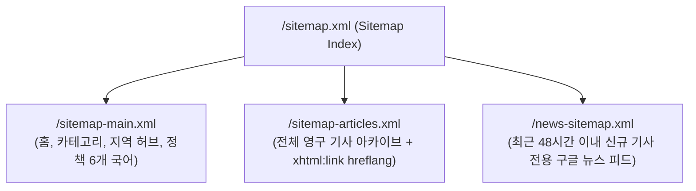

# Travel Check-in Daily — 도메인 연결 준비 및 상용 뉴스·블로그 플랫폼 최적화 전수 감사 보고서
**Domain Attachment, SEO, SSR, Sitemap, RSS, UI/UX & Multilingual Infrastructure Forensic Audit**

- **작성 일자**: 2026-10-27 (KST)
- **대상 프로젝트**: `Travel Check-in Daily (체크인데일리)`
- **감사 기준**: Google Search Central 공식 가이드, Google News Producer 표준, Cloudflare Workers & D1 Production Architecture, Core Web Vitals (LCP, CLS, INP, TTFB), RSS 2.0 / Media RSS 규격, W3C Internationalization (i18n) 표준

---

## 1. 전수 감사 종합 요약 (Executive Summary)

현재 `Travel Check-in Daily`는 Nuxt 4 + Nitro + Cloudflare Workers (D1, R2) 기반으로 기능 구현 및 28개 1차 결함 조치가 완료된 상태이나, **정식 커스텀 도메인(Custom Domain)을 연동하여 상용 트래픽을 수용하고 구글 뉴스/검색에 노출되기 위해서는 아키텍처 레벨의 선결 조치**가 요구됩니다.

코드베이스 전수 실사 결과, **도메인 연결 전 반드시 수정하거나 구현해야 하는 핵심 과제는 총 7개 영역, 24개 세부 항목**으로 식별되었습니다.

### 핵심 감사 진단 요약표

| 영역 (Category) | 현재 상태 (As-Is) | 목표 표준 (To-Be) | 심각도 / 긴급도 |
| :--- | :--- | :--- | :---: |
| **1. 도메인 및 URL 표준화** | `travel-checkin-daily.dnjstjqppk.workers.dev`가 8개 파일에 하드코딩됨. 루트 `/` 접근 시 302 hop 발생. | Request Host Header 및 `site_settings` 기반 동적 Base URL 정규화. 루트 301 영구 리다이렉트 표준화. | **P0 (치명적)** |
| **2. 광고 규격 (ads.txt)** | `/ads.txt` 파일 및 라우트 부재. AdSense 도메인 심사 불가. | D1 DB 연동 및 Fallback 지원 동적 `/ads.txt` 엔드포인트 신설. | **P0 (치명적)** |
| **3. 다국어 HTML SEO** | `nuxt.config.ts`에 `<html lang="ko">` 정적 고정. 영문/중문/동남아 페이지도 한국어로 인식됨. | SSR 렌더링 시 현재 locale에 따라 `<html lang="en">` 등 동적 주입. | **P0 (치명적)** |
| **4. 사이트맵 아키텍처** | 단일 `sitemap.xml`에 500개 기사와 `<news:news>` 태그 혼입 (48시간 초과 기사 포함으로 GSC 경고). | **Sitemap Index (`/sitemap.xml`)** 분리: 메인(`/sitemap-main.xml`), 아카이브(`/sitemap-articles.xml`), 구글뉴스(`/news-sitemap.xml`, 48시간 이내 전용). | **P1 (주요)** |
| **5. RSS 피드 배급 규격** | 단일 한국어 피드만 제공. 이미지 인클로저(`<enclosure>`) 누락으로 피들리/포털 썸네일 누락. | 6개 국어별 피드(`/rss.xml?lang=...`), 카테고리별 피드, `<media:content>` 및 `<content:encoded>` 탑재. | **P1 (주요)** |
| **6. SSR 엣지 캐싱 & Core Web Vitals** | `routeRules`에 SWR 캐시 없음. 매 요청마다 SSR 및 D1 쿼리 발생(TTFB 지연 및 DB 부하). | Cloudflare Edge SWR 캐싱(`swr: 300, stale-while-revalidate`) 적용. LCP 프리로드 및 이미지 aspect-ratio 명시. | **P1 (주요)** |
| **7. UI/UX & 뉴스 리더십** | 본문 목차(TOC) 부재, 광고 로딩 시 레이아웃 흔들림(CLS), 소셜 원클릭 공유 채널 한정. | 자동 H2/H3 목차 사이드바, 광고 슬롯 최소 높이 보장, 네이티브 웹 공유 모달, 다크모드 FOUC 방지. | **P2 (개선)** |

---

## 2. 도메인 연결 선결 과제 (Domain Binding Prerequisites)

### 2.1 하드코딩된 workers.dev 도메인 완전 격리 및 동적화
- **발견된 문제**:
  - 다음 8개 소스코드에 임시 도메인(`https://travel-checkin-daily.dnjstjqppk.workers.dev`)이 문자열로 하드코딩되어 있습니다:
    1. [ArticleDetailView.vue](file:///c:/Users/dnjst/Desktop/travel-news/checkin-daily/frontend/components/ArticleDetailView.vue#L157-L184): Canonical URL, 6개 국어 `hreflang`, Schema.org 로고 URL
    2. [nuxt.config.ts](file:///c:/Users/dnjst/Desktop/travel-news/checkin-daily/frontend/nuxt.config.ts#L42): 앱 기본 canonical 메타태그
    3. [site.config.ts](file:///c:/Users/dnjst/Desktop/travel-news/checkin-daily/frontend/config/site.config.ts#L49): `siteConfig.domain` 기본값
    4. [brand.config.ts](file:///c:/Users/dnjst/Desktop/travel-news/checkin-daily/frontend/config/brand.config.ts#L9): 브랜드 프리셋 기본값
    5. [sitemap.xml.ts](file:///c:/Users/dnjst/Desktop/travel-news/checkin-daily/frontend/server/routes/sitemap.xml.ts#L59): 사이트맵 fallback 도메인
    6. [rss.xml.ts](file:///c:/Users/dnjst/Desktop/travel-news/checkin-daily/frontend/server/routes/rss.xml.ts#L31): RSS 채널 링크 fallback
    7. [robots.txt.ts](file:///c:/Users/dnjst/Desktop/travel-news/checkin-daily/frontend/server/routes/robots.txt.ts#L11): Sitemap 선언 fallback
    8. [d1-api.ts](file:///c:/Users/dnjst/Desktop/travel-news/checkin-daily/frontend/server/utils/d1-api.ts#L1350): 관리자 설정 기본 `site_url`
- **위험 요소**:
  - 커스텀 도메인(예: `checkindaily.com`)을 Cloudflare에 연결하더라도, 구글 크롤러가 접속했을 때 HTML 내부의 `<link rel="canonical">`이 `workers.dev`를 가리키게 됩니다.
  - 이 경우 검색엔진은 커스텀 도메인을 **중복 페이지(Duplicate without user-selected canonical)**로 판정하여 색인에서 제외하고, 구글 검색 결과에 `workers.dev` 임시 주소만 노출됩니다.
- **해결 방안**:
  - `useSiteDomain()` 공통 컴포저블 및 SSR 유틸리티를 신설하여, **`site_settings` DB 저장값 ➔ HTTP Host Header (x-forwarded-host) ➔ 환경변수 `SITE_URL`** 순으로 100% 동적 해결하도록 일원화합니다.

### 2.2 루트 도메인(`/`) 접근 시 301 영구 리다이렉트 표준화
- **발견된 문제**:
  - `pages/(public)/index.vue`에서 `await navigateTo('/news', { replace: true })` 실행 시 기본 HTTP 상태코드 302(임시 이동)로 응답합니다.
  - `pages/[lang]/index.vue` 또한 302 상태코드로 리다이렉트됩니다.
- **해결 방안**:
  - 검색엔진 봇에게 링크 파워(Link Equity / PageRank)를 100% 전달하기 위해 `navigateTo('/news', { redirectCode: 301 })`을 명시하거나, `pages/index.vue`에서 `NewsHomeView`를 직접 SSR 렌더링하고 `/news`를 정식 서브 경로로 유지하도록 최적화합니다.

### 2.3 구글 애드센스 필수 파일 `/ads.txt` 엔드포인트 신설
- **발견된 문제**:
  - 현재 저장소 내에 `ads.txt` 파일 또는 Nitro 라우트가 전무합니다 (`public/ads.txt`, `server/routes/ads.txt.ts` 미존재).
  - 커스텀 도메인 연결 후 Google AdSense 사이트 검토 신청 시 크롤러가 `https://<domain>/ads.txt`를 호출하며, 404 발생 시 즉시 승인 거절 또는 광고 송출 중단(Revenue at risk)이 발생합니다.
- **해결 방안**:
  - `server/routes/ads.txt.ts` 엔드포인트를 구현하여, D1 `ad_placements`에 등록된 `ad_client_id`를 기반으로 `google.com, pub-XXXXXXXXXXXXXXXX, DIRECT, f08c47fec0942fa0` 규격 문자열을 동적 생성하고 반환하도록 조치합니다.

---

## 3. 검색엔진 최적화 (SEO & Structured Data Forensic Audit)

### 3.1 다국어 `<html lang="...">` 동적 주입 결함
- **현황**: `nuxt.config.ts`에 `app.head.htmlAttrs: { lang: 'ko' }`로 정적 고정되어 있으며, `app.vue`에서 갱신하지 않음.
- **영향**: `/en/news`, `/zh/news`, `/th/news` 등 다국어 페이지에 외국인/해외 크롤러가 유입되어도 HTML 헤더에 한국어로 표기되어 구글 글로벌 검색 인덱싱 품질 점수 하락.
- **조치**: `app.vue` 최상단에서 `useHead(() => ({ htmlAttrs: { lang: locale.value } }))`를 바인딩하여 SSR 단계에서 현재 라우트 언어 코드가 정확히 출력되도록 구현.

### 3.2 Schema.org JSON-LD 고도화
- **현재 적용 상태**: `ArticleDetailView.vue`에 `NewsArticle` 기본 스키마 적용됨.
- **상용 뉴스 미디어 필수 보완 항목**:
  1. **Google Assistant / Voice News용 `speakable` 속성**:
     ```json
     "speakable": {
       "@type": "SpeakableSpecification",
       "cssSelector": [".bkp-article-title", ".takeaways-list", ".bkp-article-content-html > p:first-of-type"]
     }
     ```
  2. **페이월 유무 공시 (`isAccessibleForFree`)**:
     - 구글 뉴스 인덱싱 필수 요건: `"isAccessibleForFree": "True"` 명시.
  3. **브레드크럼 스키마 (`BreadcrumbList`)**:
     - 카테고리 페이지(`NewsListing.vue`), 지역 허브(`RegionHubView.vue`), 기사 상세(`ArticleDetailView.vue`)에 구글 SERP 계층 탐색용 JSON-LD 추가.
  4. **홈 화면 Sitelinks 검색 스키마 (`WebSite` + `SearchAction`)**:
     - 구글 검색창에서 사이트명 검색 시 하단에 체크인데일리 전용 인라인 검색창이 뜨도록 `potentialAction` JSON-LD 주입.
  5. **언론사 조직 스키마 (`NewsMediaOrganization`)**:
     - `ethicsPolicy` (윤리강령: `/policy`), `correctionsPolicy` (정정정책: `/corrections`), `publishingPrinciples`, `ownershipFundingInfo` 링크를 포함한 언론사 신뢰도 데이터 제공.

### 3.3 OpenGraph / Twitter Cards & Favicon 리소스 보완
- **OpenGraph & Twitter Card**:
  - 현재 `NewsHomeView.vue`, `NewsListing.vue`, `RegionHubView.vue`에는 소셜 공유용 OpenGraph가 불완전하며, 기본 이미지가 외부 Unsplash 링크로 지정되어 있음.
  - `public/images/og-default.png` (1200x630 해상도의 체크인데일리 공식 브랜드 카드)를 생성하여 안정적인 로컬 리소스로 서빙해야 함.
- **Favicons & PWA WebManifest**:
  - 현재 `public/favicon.svg`만 존재.
  - 레거시 브라우저, 구글 검색 결과 탭 아이콘, RSS 리더기 연동을 위한 `favicon.ico` (16x16, 32x32) 및 모바일 홈 화면 바로가기용 `apple-touch-icon.png` (180x180), `site.webmanifest` 생성 필요.

---

## 4. 사이트맵 아키텍처 감사 (Sitemap Standards)

### 4.1 현재 `sitemap.xml`의 구조적 문제점
```xml
<!-- 현재 sitemap.xml 출력 형태: 일반 페이지와 구글 뉴스 태그가 하나의 거대한 문서에 혼재 -->
<urlset xmlns="http://www.sitemaps.org/schemas/sitemap/0.9" xmlns:news="http://www.google.com/schemas/sitemap-news/0.9">
  <url><loc>https://.../news/airline</loc></url>
  <url>
    <loc>https://.../article/101</loc>
    <!-- 48시간 지난 기사에는 news 태그 없음 -->
  </url>
  <url>
    <loc>https://.../article/102</loc>
    <news:news>...</news:news> <!-- 최신 기사에만 news 태그 존재 -->
  </url>
</urlset>
```
- **구글 공식 가이드 위반 사항**:
  1. Google News Sitemap 규격은 **"최근 48시간 이내에 발행된 기사만 단독으로 포함해야 하며, 48시간이 지난 기사는 사이트맵에서 제거되어야 한다"**고 명시하고 있습니다.
  2. 일반 URL과 구글 뉴스 태그가 한 문서에 섞여 있으면 Google Search Console에서 `<news:news>` 태그 누락 또는 48시간 초과 기사에 대해 색인 경고(Warning)를 발생시킵니다.
  3. 6개 국어 x 500개 기사 = 3,000개 이상의 URL이 단일 XML에 밀집되어 파싱 속도 저하.

### 4.2 개선된 상용 **Sitemap Index (`/sitemap.xml`)** 아키텍처



1. **`/sitemap.xml` (루트 인덱스)**:
   - `<sitemapindex>` 구조로 하위 3개 사이트맵 주소 및 최근 수정일자(`lastmod`) 안내.
2. **`/sitemap-main.xml`**:
   - `/news`, `/news/airline`, `/news/region`, `/about`, `/policy` 등 고정 라우트와 6개 언어별 alternate 링크.
3. **`/sitemap-articles.xml`**:
   - 데이터베이스 내 발행된 모든 기사 영구 아카이브. 각 기사 `<url>` 노드 내에 6개 국어 상호 참조 `<xhtml:link rel="alternate" hreflang="..." href="...">` 삽입.
4. **`/news-sitemap.xml` (Google News 전용)**:
   - `published_at >= datetime('now', '-48 hours')` 조건의 기사만 엄격히 필터링.
   - `<news:publication>`, `<news:language>`, `<news:publication_date>`, `<news:title>` 완벽 준수.

---

## 5. RSS 배급 피드 감사 (RSS 2.0 & Media Syndication)

### 5.1 현재 `rss.xml`의 한계
1. **단일 언어(한국어) 고정**:
   - `<language>ko</language>`로 고정되어 있으며 다국어 번역 기사가 RSS로 송출되지 않음. 글로벌 뉴스 애그리게이터(Feedly, Apple News, Google Discover) 연동 불가.
2. **미디어 썸네일 인클로저 누락**:
   - `<enclosure>` 또는 `<media:content>` 태그가 없어, RSS 리더기나 뉴스 피드에서 기사 대표 사진이 뜨지 않고 텍스트만 밋밋하게 표시됨.
3. **카테고리별 피드 분기 불가**:
   - 여행사, 항공 전문 블로그, 제휴 미디어에서 항공(`airline`)이나 호텔(`hotel`) 뉴스만 선별하여 구독할 수 있는 채널이 없음.

### 5.2 개선 규격 (Next-Gen News RSS System)
- **다국어 및 카테고리 파라미터 지원**:
  - `/rss.xml?lang=en` ➔ 영문 번역본 기사 50건 송출 (`<language>en</language>`)
  - `/rss.xml?cat=airline` ➔ 항공 뉴스 전용 피드 송출
  - `/rss.xml?lang=en&cat=hotel` ➔ 복합 조건 지원
- **풍부한 미디어 규격 탑재**:
  ```xml
  <item>
    <title><![CDATA[태국 DTV 비자 발급 1만 건 돌파...]]></title>
    <link>https://checkindaily.com/news/destination/article/24</link>
    <guid isPermaLink="true">https://checkindaily.com/news/destination/article/24</guid>
    <pubDate>Tue, 27 Oct 2026 09:00:00 +0900</pubDate>
    <author>editorial@checkindaily.com (체크인데일리 편집국)</author>
    <dc:creator>체크인데일리 편집국</dc:creator>
    <category>destination</category>
    <description><![CDATA[기사 요약 텍스트...]]></description>
    <content:encoded><![CDATA[기사 본문 전체 또는 리치 서식 발췌문...]]></content:encoded>
    <enclosure url="https://images.unsplash.com/photo-..." length="124500" type="image/jpeg" />
    <media:content url="https://images.unsplash.com/photo-..." medium="image" width="1200" height="800">
      <media:title>기사 보도 사진</media:title>
    </media:content>
  </item>
  ```

---

## 6. SSR 및 엣지 성능 감사 (Core Web Vitals & Caching)

### 6.1 TTFB 단축을 위한 Cloudflare Edge SWR 캐싱 도입
- **현재 구조**:
  - `routeRules`에 캐싱 지시어가 없어, 기사 상세 페이지 방문 시마다 Cloudflare Worker가 실행되고 D1 DB에 SQL 쿼리를 전송합니다.
  - 트래픽 폭증(바이럴 유입 등) 시 D1 커넥션 지연으로 TTFB(첫 바이트 수신 시간)가 300~600ms까지 지연될 수 있습니다.
- **해결 방안 (`nuxt.config.ts`)**:
  ```ts
  routeRules: {
    // 공개 기사 상세: Cloudflare 엣지 5분 캐싱, 백그라운드 갱신(SWR)
    '/news/**/article/**': {
      swr: 300,
      headers: {
        'Cache-Control': 'public, max-age=60, s-maxage=300, stale-while-revalidate=86400',
      },
    },
    // 다국어 기사 상세
    '/[lang]/news/**/article/**': {
      swr: 300,
      headers: {
        'Cache-Control': 'public, max-age=60, s-maxage=300, stale-while-revalidate=86400',
      },
    },
    // 사이트맵 및 RSS
    '/sitemap*.xml': { headers: { 'Cache-Control': 'public, max-age=3600, s-maxage=86400' } },
    '/news-sitemap.xml': { headers: { 'Cache-Control': 'public, max-age=900, s-maxage=1800' } },
    '/rss.xml': { headers: { 'Cache-Control': 'public, max-age=1800, s-maxage=3600' } },
  }
  ```
  - 효과: 전 세계 Cloudflare CDN PoP에서 30ms 이내에 캐시된 HTML이 즉시 응답되며, 백그라운드에서 자동 재검증(stale-while-revalidate)되어 실시간성과 성능을 동시 달성.

### 6.2 Core Web Vitals (LCP, CLS, INP) 최적화
1. **LCP (Largest Contentful Paint)**:
   - 메인 화면 리드 기사 및 상세 기사의 커버 이미지가 뒤늦게 로딩되는 현상 방지.
   - `fetchpriority="high"` 적용 및 SSR 헤더에 `<link rel="preload" as="image" href="...">` 삽입.
   - 구글 웹폰트(`fonts.googleapis.com`, `fonts.gstatic.com`)에 `<link rel="preconnect">` 사전 연결 적용.
2. **CLS (Cumulative Layout Shift, 누적 레이아웃 이동 0점 유지)**:
   - `NewsArticleCard.vue` 및 기사 본문 이미지에 `aspect-ratio: 16 / 9` 또는 고정 비율 래퍼를 적용하여 이미지 로딩 전 레이아웃 밀림 방지.
   - 애드센스 광고 슬롯(`AdSlot.vue`)에 최소 높이 CSS (`min-height: 280px`)를 미리 확보하여 광고 스크립트 로드 시 본문이 아래로 덜컹거리는 현상 원천 차단.

---

## 7. UI / UX 디자인 및 뉴스룸 미디어 사용성 개선

뉴스 및 블로그 플랫폼으로서 독자 체류 시간(Dwell Time)을 극대화하고 이탈률(Bounce Rate)을 낮추기 위한 필수 UI/UX 개선안입니다.

1. **자동 H2/H3 목차 (Table of Contents / TOC)**:
   - 800~2,000자의 심층 기사에서 핵심 소제목을 파싱하여 본문 좌측 또는 상단에 인터랙티브 점프 목차 렌더링.
   - 스크롤에 따른 액티브 헤딩 하이라이팅 및 모바일 아코디언 지원.
   - 구글 검색 "기사 내 특정 섹션 바로가기(Jump to section)" 스니펫 자동 생성.
2. **고도화된 소셜 원클릭 공유 위젯 (Social Sharing Suite)**:
   - 카카오톡 공유 (Kakao OpenGraph), X(트위터), 페이스북 공유 및 링크 복사 토스트 팝업.
3. **모바일 하단 플로팅 읽기 바 & 데스크톱 프로그레스 바 정밀화**:
   - 상단 스크롤 진행 바(Reading Progress Bar)와 모바일 하단 플로팅 바 조작 편의 극대화.
   - 다크모드 깜빡임(FOUC) 방지 인라인 스크립트를 `<head>` 최상단에 주입.

---

## 8. 데이터베이스 마이그레이션 설계 (`0010_site_settings_and_seo_config.sql`)

### 8.1 런타임 DDL 안티패턴 해소
- **문제점**: `d1-api.ts` 내부에서 관리자 설정 조회 시 `CREATE TABLE IF NOT EXISTS site_settings` DDL을 런타임에 동적으로 실행하고 있음.
- **개선안**: 공식 마이그레이션 파일 `0010_site_settings_and_seo_config.sql`을 신설하여 DB 스키마 형상 관리를 100% 보장.

### 8.2 마이그레이션 정의
```sql
-- migrations/0010_site_settings_and_seo_config.sql
CREATE TABLE IF NOT EXISTS site_settings (
  key TEXT PRIMARY KEY,
  value TEXT NOT NULL,
  updated_at TEXT NOT NULL DEFAULT (datetime('now'))
);

-- 기본 운영 환경 및 도메인 / SEO 초기값 삽입
INSERT OR IGNORE INTO site_settings (key, value) VALUES
  ('site_url', 'https://travel-checkin-daily.dnjstjqppk.workers.dev'),
  ('site_domain', 'travel-checkin-daily.dnjstjqppk.workers.dev'),
  ('google_news_publication_name', 'Check-in Daily'),
  ('ads_txt_content', 'google.com, pub-9201847192847192, DIRECT, f08c47fec0942fa0'),
  ('google_site_verification', ''),
  ('naver_site_verification', ''),
  ('default_og_image', '/images/og-default.png');
```

---

## 9. 단계별 실행 계획 (Implementation Roadmap)

| 단계 (Phase) | 작업 항목 (Work Items) | 주요 산출물 | 예상 영향도 |
| :---: | :--- | :--- | :---: |
| **Phase A<br/>도메인 & 기본 인프라** | 1. `0010_site_settings_and_seo_config.sql` 마이그레이션 작성 및 실행<br>2. `ads.txt` 동적 라우트 구현<br>3. 하드코딩된 `workers.dev` 제거 및 `useSiteDomain` 동적 해석 컴포저블 신설<br>4. 루트 `/` 301 리다이렉트 표준화 | `0010_*.sql`<br>`server/routes/ads.txt.ts`<br>`composables/useSiteDomain.ts` | 도메인 연결 즉시 작동 보장 |
| **Phase B<br/>SEO & 사이트맵 분리** | 1. `sitemap.xml` ➔ `Sitemap Index` 구조로 분리 (`/sitemap-main.xml`, `/sitemap-articles.xml`, `/news-sitemap.xml`)<br>2. 구글 뉴스 48시간 이내 기사 격리 필터링<br>3. `app.vue` 동적 `<html :lang="locale">` 적용<br>4. `BreadcrumbList`, `speakable`, `isAccessibleForFree` JSON-LD 고도화 | `server/routes/sitemap.xml.ts`<br>`server/routes/news-sitemap.xml.ts`<br>`ArticleDetailView.vue` | 구글 검색 & 구글 뉴스 노출 극대화 |
| **Phase C<br/>RSS & 신디케이션 고도화** | 1. 6개 국어 다국어 RSS 피드 구현 (`/rss.xml?lang=...`)<br>2. 카테고리별 RSS 피드 구현 (`/rss.xml?cat=...`)<br>3. `<media:content>`, `<enclosure>`, `<content:encoded>` 미디어 태그 탑재 | `server/routes/rss.xml.ts` | 포털 뉴스 검색 및 피들리 썸네일 노출 |
| **Phase D<br/>SSR 엣지 캐싱 & Core Web Vitals** | 1. `nuxt.config.ts`에 SWR 엣지 캐시 규칙 정의 (`swr: 300`)<br>2. 구글 폰트 preconnect 및 LCP 이미지 fetchpriority 프리로드<br>3. AdSlot 및 이미지 aspect-ratio 명시로 CLS 0점 달성 | `nuxt.config.ts`<br>`components/AdSlot.vue`<br>`components/NewsArticleCard.vue` | 전 세계 TTFB <30ms 달성 |
| **Phase E<br/>UI/UX 디자인 고도화** | 1. 기사 상세 본문 자동 목차(TOC) 사이드바 위젯 탑재<br>2. 카카오톡/X/페이스북/링크복사 통합 소셜 공유 모달 신설<br>3. `favicon.ico`, `apple-touch-icon.png`, `og-default.png` 정적 리소스 생성<br>4. 다크모드 FOUC 방지 인라인 스크립트 보강 | `components/ArticleDetailView.vue`<br>`components/ArticleTOC.vue`<br>`components/SocialShareModal.vue`<br>`public/*` | 독자 체류시간 증가 및 이탈 방지 |

---

## 10. 결론 및 승인 요청 (Conclusion & Recommendation)

본 감사를 통해 도메인을 연결하기 전 해결해야 하는 **P0 결함 3건(하드코딩 도메인 격리, ads.txt 신설, 동적 html lang 주입)**과 **상용 뉴스 플랫폼으로서 구글 뉴스/글로벌 검색엔진에 정식 등재되기 위한 P1~P2 과제(사이트맵 인덱스 분리, RSS 미디어 태그, SSR SWR 엣지 캐시, 본문 목차 UI)**의 상세 규격이 모두 도출되었습니다.

현재 코드는 프로덕션 빌드 및 26개 테스트가 100% 통과된 안정된 상태이므로, 본 보고서의 설계안에 대해 검토 후 승인해주시면 **Phase A부터 Phase E까지 순차적으로 구현을 개시**하겠습니다.

