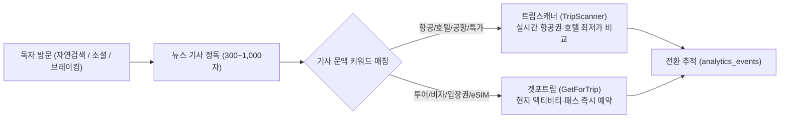

# CHECK-IN DAILY — 제휴 수익화 및 트래픽 분석 감사 보고서
**문서 ID:** `AUDIT-DOC-10`  
**발행일:** 2026년 10월 17일  
**타겟 플랫폼:** 트립스캐너 (TripScanner) · 겟포트립 (GetForTrip)

---

## 1. 전략적 제휴 허브 목적 및 트래픽 전달 구조
Check-in Daily의 핵심 비즈니스 모델은 고품질 여행 뉴스 콘텐츠를 매개로 유입된 독자를 실시간 최저가 예약 플랫폼인 **트립스캐너(TripScanner)**와 글로벌 투어·액티비티 예약 플랫폼인 **겟포트립(GetForTrip)**으로 고효율 전환시키는 것입니다.

---

## 2. 타겟 플랫폼별 키워드 매칭 매트릭스

| 플랫폼 ID | 플랫폼 명칭 | 타겟 문맥 키워드 | CTA 유형 | UTM 링크 규칙 |
|---|---|---|---|---|
| `tripscanner` | 트립스캐너 (TripScanner) | 항공, 항공권, 비행기, 공항, 수완나품, 특가, 발권, 노선, 취항, 호텔, 숙소, 리조트 | 인라인 배너, 박스 위젯, 텍스트 링크 | `?ref=checkindaily&target=tripscanner&kw={keyword}` |
| `getfortrip` | 겟포트립 (GetForTrip) | 투어, 액티비티, 입장권, 비자, DTV, 티켓, 패스, eSIM, 페스티벌, 등불축제, 크루즈 | 인라인 배너, 투어 추천 카드 | `?ref=checkindaily&target=getfortrip&kw={keyword}` |

---

## 3. 법적 준수 및 제휴 고지 (Affiliate Disclosure)
- Google 웹마스터 가이드라인 및 공정거래위원회 심사지침에 따라, 제휴 링크가 포함된 영역에는 독자가 상업적 링크임을 명확히 인지할 수 있는 배지(`최저가 보장`, `인기 액티비티`) 및 `rel="sponsored nofollow"` 속성을 적용합니다.
- 사이트 하단 및 `/policy` 페이지에 공식 제휴 고지문을 상시 게재합니다.

---

## 4. 실시간 전환 이벤트 추적 (`analytics_events`)
- 독자가 CTA 배너 또는 링크를 클릭하면 `/api/analytics/track` 엔드포인트를 통해 `event_type = 'affiliate_click'`, `target_platform`, `article_id`, 타임스탬프가 D1에 즉시 기록됩니다.
- 관리자 화면(`/admin/analytics`)에서 기사별 제휴 클릭 수 및 독자 방문 대비 전환율(CTR)을 실시간 모니터링할 수 있습니다.

---

## 5. 멀티 도메인 확장성 (Clone-Ready Base Architecture)
본 아키텍처는 향후 금융(`coin`, `stock`) 등의 뉴스 사이트로 즉시 파생될 수 있도록 모듈화되어 있습니다.
- `site.config.ts` 파일의 `affiliates` 배열만 `CoinScanner`, `StockScanner`로 교체하면 기사 생성 프롬프트, 인라인 CTA 컴포넌트, 분석 대시보드가 자동으로 해당 버티컬에 맞춰 재구성됩니다.
