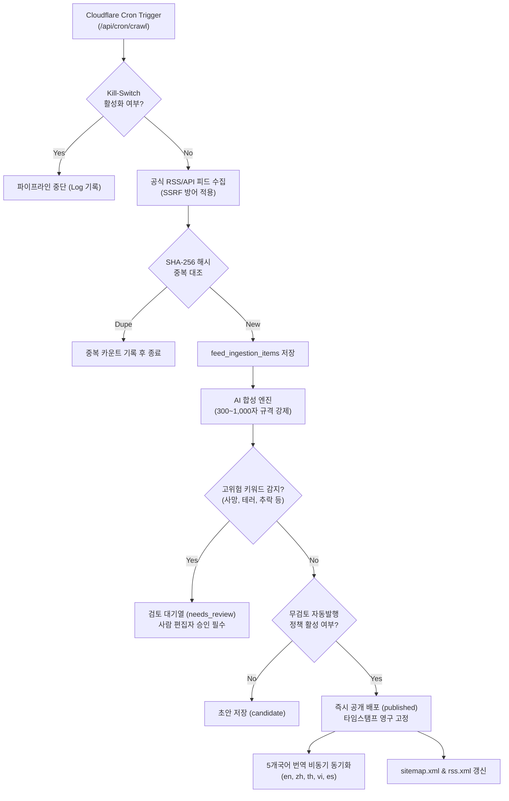

# CHECK-IN DAILY — 자동 발행 파이프라인 및 클라우드 아키텍처
**문서 ID:** `AUDIT-DOC-05`  
**감사 대상:** Cloudflare Workers, Cron Triggers, D1 Relational Engine, 자동 발행 안전 가드레일  
**발행일:** 2026년 10월 17일

---

## 1. 아키텍처 개요
Check-in Daily의 자동 수집 및 발행 파이프라인은 서버리스 엣지 환경인 Cloudflare Workers 및 D1 분산 SQL 데이터베이스를 기반으로 구축되어, 고가용성과 초저지연 배포를 실현합니다.

---

## 2. 핵심 파이프라인 단계별 구현

### 2.1. Cloudflare Cron Triggers 및 보안
- `wrangler.toml`에 정의된 주기(기본 1시간/출처별 간격)에 따라 Worker가 트리거됩니다.
- 엔드포인트는 `x-cron-token` 헤더 인증을 통해 외부 악의적 호출을 차단합니다.
- 시간대는 UTC로 처리되며 독자 표시 시점에는 `Asia/Seoul (KST)`로 자동 포맷팅됩니다.

### 2.2. 글자 수 엄격 강제 엔진 (`enforceCharacterCount`)
생성되는 모든 기사는 공백 포함 **최소 300자 이상 ~ 최대 1,000자 이하**를 강제합니다.
1. **과다 분량 축소 (> 980자):** 마크다운 문장 종결 부호(`. `, `! `, `? `)를 역방향 탐색하여 문맥 훼손 없이 950자 이내에서 자연스럽게 절단 후 제휴 CTA 블록을 결합.
2. **분량 부족 확장 (< 300자):** 팩트 기반 업계 동향 및 여행자 실무 가이드 단락을 자동으로 보강하여 300자 이상을 충족.
3. **최종 안전 클램프:** 1,000자 초과 시 990자에서 안전 절단 처리.

### 2.3. 예약 발행 디스패치 (`publish_jobs`)
- 승인된 기사는 `publish_jobs` 테이블에 예약 시각(`scheduled_at`)과 고유 멱등키(`idempotency_key`)로 등록됩니다.
- 지정 시각 도달 시 워커가 원자적 트랜잭션으로 기사 상태를 `published`로 전환하고 `published_at`을 최초 부여합니다.

### 2.4. 배포 후 자동 검증 (Post-Publish Verification)
기사가 발행되면 시스템은 다음 항목을 즉시 검증합니다.
1. 공개 URL 응답 코드 (HTTP 200)
2. OpenGraph 및 NewsArticle Schema.org JSON-LD의 제목/일자 정합성
3. `sitemap.xml` 및 `rss.xml` 내 신규 URL 자동 포함 여부
