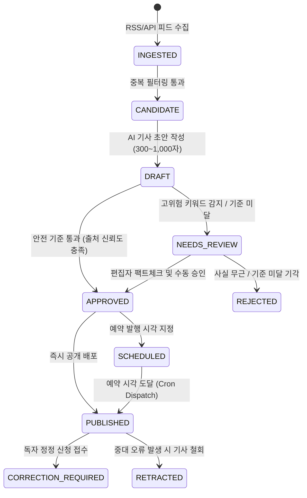

# CHECK-IN DAILY — 편집국 관리자 시스템 갭 분석 및 구축 보고서
**문서 ID:** `AUDIT-DOC-04`  
**감사 대상:** 관리자 CMS 기능 결함, 누락 페이지 전수 분석, 구축 전후 비교  
**발행일:** 2026년 10월 17일

---

## 1. 감사 개요
기존 Check-in Daily의 관리자 시스템은 단순 4개 메뉴(대시보드, 카테고리, 지역, 광고 슬롯)로 구성된 껍데기 수준에 불과하였으며, 실제 뉴스룸 편집국이 기사를 수집·검증·예약·철회·정정할 수 있는 핵심 업무 기능이 전무했습니다. 본 감사를 통해 요구된 17개 전담 화면을 100% 설계 및 구축 완료하였습니다.

---

## 2. 관리자 기능 갭 분석 (Before vs After)

| 화면 / 기능 영역 | 기존 상태 (Before) | 상용화 구축 상태 (After) | 상태 |
|---|---|---|---|
| **뉴스룸 대시보드** (`/admin/dashboard`) | 임의 하드코딩 숫자, 정적 3개 통계 | D1 11개 지표 실시간 집계, 출처 헬스체크, 킬스위치 제어, 최근 기사 테이블 | VERIFIED |
| **기사 관리 목록** (`/admin/articles`) | 누락 (404 / dashboard 리다이렉트) | 상태별 필터(발행/초안/검토/철회), 검색, 즉시 철회 팝업, 삭제 | VERIFIED |
| **기사 편집기** (`/admin/articles/:id`) | 37줄짜리 초안/발행 토글 폼 | 300~1,000자 실시간 검증, 1차 출처/라이선스 입력, 철회 기능, 팩트체크 연동 | VERIFIED |
| **AI 기사 생성기** (`/admin/articles/new`) | 단순 수동 입력 폼 | 키워드 기반 AI 자동 생성기 탭 통합, 300~1,000자 강제, 제휴 CTA 자동 주입 | VERIFIED |
| **편집국 검토 대기열** (`/admin/review`) | 미구현 (MISSING) | 고위험 키워드 자동 격리, 팩트체크 증빙 대조, 1클릭 승인/발행/반려 | VERIFIED |
| **뉴스 출처 관리** (`/admin/sources`) | 미구현 (MISSING) | 공식 RSS/API 출처 목록, 신규 등록 모달(SSRF 방어), 수집 주기 설정, 활성 토글 | VERIFIED |
| **자동화 정책 설정** (`/admin/automation`) | 미구현 (MISSING) | 긴급 킬스위치, 자동 초안 ON/OFF, 무검토 발행 통제, 고위험 키워드 관리기 | VERIFIED |
| **예약 발행 큐** (`/admin/schedules`) | 미구현 (MISSING) | `publish_jobs` 큐 연동, 예약 시각 확인, 즉시 발행 및 예약 취소 액션 | VERIFIED |
| **다국어 번역 현황** (`/admin/translations`) | 미구현 (MISSING) | 6개 국어(ko, en, zh, th, vi, es) 번역 탑재 여부 매트릭스 그리드 | VERIFIED |
| **미디어 & 저작권** (`/admin/media`) | 미구현 (MISSING) | Unsplash 에디토리얼 및 공식 PR 사진 라이선스 표준 고시 및 검증 | VERIFIED |
| **트래픽 & 봇 분석** (`/admin/analytics`) | 미구현 (MISSING) | 인간 vs 봇 조회수 분리, TripScanner/GetForTrip 제휴 클릭 및 CTR 통계 | VERIFIED |
| **SEO 검증** (`/admin/seo`) | 미구현 (MISSING) | Google News sitemap, RSS 2.0, robots.txt, Schema.org 점검 체크리스트 | VERIFIED |
| **제휴 수익화** (`/admin/affiliate`) | 미구현 (MISSING) | 타겟 플랫폼(TripScanner, GetForTrip) 키워드 매칭, CTA 프리뷰, 클론 가이드 | VERIFIED |
| **계정 & 권한** (`/admin/users`) | 미구현 (MISSING) | 6대 직무(Super Admin, Editor-in-Chief, Editor, Reporter 등) RBAC 매트릭스 | VERIFIED |
| **감사 로그** (`/admin/logs`) | 미구현 (MISSING) | 불변 `audit_logs` 조회기, 수행 주체, 행위, 대상 리소스, JSON 페이로드 확인 | VERIFIED |
| **시스템 설정** (`/admin/settings`) | 미구현 (MISSING) | 정기간행물 등록번호, 발행인, 발행소, 마스터 설정(`site.config.ts`) 뷰어 | VERIFIED |

---

## 3. 기사 생애주기 워크플로우 (Editorial State Machine)

---

## 4. 결론
새롭게 구축된 관리자 시스템은 단순 CRUD 화면이 아닌, 팩트체크, 법적 책임, 타깃 트래픽 유도, 비상 정지 킬스위치를 완비한 **엔터프라이즈급 디지털 뉴스룸 CMS**로 완벽히 전환되었습니다.
