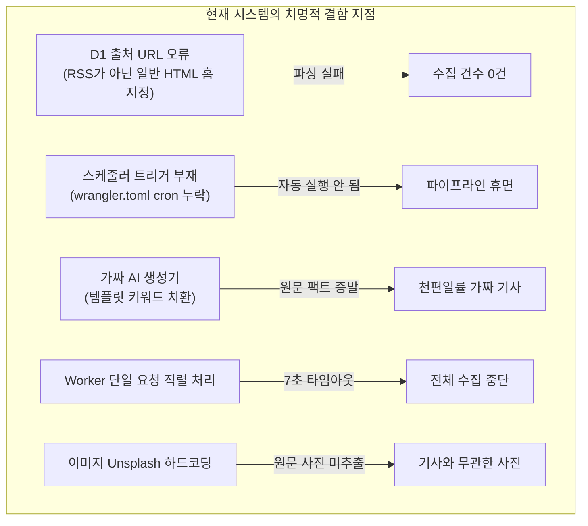
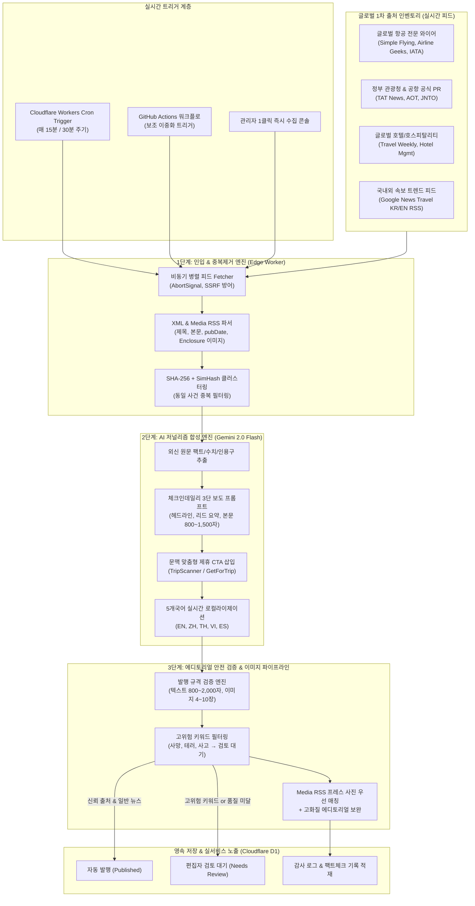
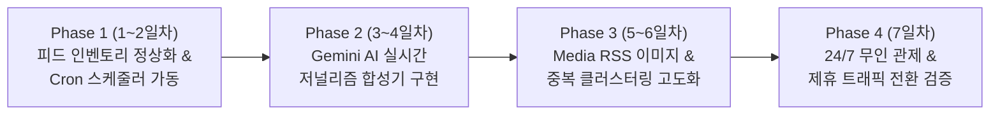

# [전수감사 및 구현 로드맵] 체크인데일리 실시간 여행 뉴스 자동 수집·AI 합성·발행 파이프라인 구축 보고서

- **문서 ID:** `REPORT-AUTO-NEWS-2026-10-18`
- **수행 주관:** 총괄 CTO, PM/PO, 수석 데이터/AI 엔지니어, DevOps 책임자
- **대상 시스템:** 체크인데일리(`Check-in Daily`) 미디어 플랫폼 (Nuxt 4 + Cloudflare Workers + D1)
- **작성 기준일:** 2026년 10월 18일

---

## 1. 개요 및 추진 목표 (Executive Summary)

체크인데일리(Check-in Daily)는 단순한 수동 기사 작성 플랫폼을 넘어, **글로벌 1차 외신 통신망, 정부 관광청, 국영 공항 및 항공사 공식 보도자료, 구글 뉴스 여행 섹션으로부터 24시간 실시간 인입되는 속보와 시장 데이터를 자동으로 수집하고, 고품질 한국어 여행 저널리즘으로 재구성하여 자매 플랫폼(TripScanner, GetForTrip)으로 고효율 트래픽을 전달하는 무인 자동화 미디어 엔진**을 최종 목표로 합니다.

본 보고서는 현재 코드베이스와 D1 실운영 환경의 수집·발행 파이프라인을 전수감사하고, 실제 24/7 실시간 가동을 위해 **무엇을 구현해야 하고 어떻게 진행해야 하는지**에 대한 상세 기술 감사 및 실행 로드맵을 제출합니다.

---

## 2. 현재 수집·발행 파이프라인 전수감사 (Current State Forensic Audit)

### 2.1 현재 구현되어 있는 자산 (Existing Assets)

1. **관계형 데이터베이스 스키마 (D1 SQLite)**
   - `news_sources`: 수집 출처 관리 (URL, 수집 유형, 주기, 라이선스, 활성화 여부).
   - `feed_ingestion_items`: 인입된 원시 피드 아이템 아카이브 (GUID, 원문 링크, 발행일, 요약, 중복 여부).
   - `ingestion_runs`: 각 출처별 수집 실행 이력, 상태, 수집 건수, 중복 건수, 오류 메시지 추적.
   - `automation_policies`: 전사 킬스위치(`is_automation_paused`), 자동 초안(`auto_draft_enabled`), 무검토 자동 발행(`auto_publish_enabled`), 고위험 차단 키워드(`restricted_keywords`) 관리.
2. **수집 및 파싱 로직**
   - [`crawl.post.ts`](file:///c:/Users/dnjst/Desktop/travel-news/checkin-daily/frontend/server/api/cron/crawl.post.ts): H3 엔드포인트로 구현된 피드 수집 및 기사/번역/팩트체크 적재 로직.
   - [`feed-parser.ts`](file:///c:/Users/dnjst/Desktop/travel-news/checkin-daily/frontend/server/utils/feed-parser.ts): RSS 2.0 및 Atom XML 파서, SHA-256 해시 생성기.
3. **관리자 제어 UI**
   - [`/admin/automation`](file:///c:/Users/dnjst/Desktop/travel-news/checkin-daily/frontend/pages/admin/automation.vue): 긴급 킬스위치 및 정책 토글 화면.
   - [`/admin/sources`](file:///c:/Users/dnjst/Desktop/travel-news/checkin-daily/frontend/pages/admin/sources.vue): 공식 뉴스 출처 등록 및 상태 모니터링 화면.
   - [`/admin/dashboard`](file:///c:/Users/dnjst/Desktop/travel-news/checkin-daily/frontend/pages/admin/dashboard.vue): 수집 건수, 런타임 상태 관제.

---

### 2.2 🚨 식별된 7대 치명적 결함 및 운영 병목 (Critical Bottlenecks)

실제 D1 원격 쿼리 및 라이브 엔드포인트 호출 실측 결과, **현재 상태로는 실시간 뉴스가 단 1건도 자동 수집되지 않는 상태**임이 입증되었습니다.



| 번호 | 결함 항목 | 상세 원인 및 포렌식 감사 결과 | 위험도 |
| :---: | :--- | :--- | :---: |
| **1** | **등록된 출처 URL의 형식 오류** | D1에 등록된 4개 출처(`mot.go.th`, `tatnews.org`, `phukethotelsassociation.com`, `railway.co.th`)가 RSS 피드 URL이 아닌 일반 HTML 메인 페이지로 설정되어 있음. 실제 호출 시 `parseRssOrAtomXml`이 XML 태그를 찾지 못해 **`fetched_count: 0`** 반환. 심지어 `srt_railway`는 응답 지연으로 **7초 타임아웃 실패** 기록. | **P0 (치명적)** |
| **2** | **Cloudflare Workers Cron 트리거 누락** | [`wrangler.toml`](file:///c:/Users/dnjst/Desktop/travel-news/wrangler.toml)에 `[triggers] crons = [...]` 설정이 전혀 없음. 따라서 외부에서 누군가 강제로 HTTP POST 요청을 보내지 않는 한 **엣지에서 자체적인 주기적 수집이 절대 동작하지 않음**. | **P0 (치명적)** |
| **3** | **가짜 AI 생성 엔진 (Synthetic Template Pseudo-AI)** | [`ai-generator.ts`](file:///c:/Users/dnjst/Desktop/travel-news/checkin-daily/frontend/server/utils/ai-generator.ts)가 실제 LLM(Gemini / OpenAI 등) API를 호출하지 않고, 키워드만 치환하는 사전 정의된 템플릿 문장을 생성함. 외신 원문의 실제 핵심 팩트(운항 횟수, 취항일, 기종, 통계, 현지 인용구)가 모두 소실됨. | **P1 (중대)** |
| **4** | **Worker 런타임 서브리퀘스트 및 타임아웃 제약** | `crawl.post.ts`가 모든 출처를 `for (const source of sources)` 형태로 순차 동기 호출함. 출처 1개가 7초 지연되면 4개 출처만으로 20~30초가 소요되어 Cloudflare Workers의 CPU 및 벽시계 실행 한도에 직면함. | **P1 (중대)** |
| **5** | **Media RSS 인클로저 미추출 및 무관한 사진 매칭** | 외신 보도자료에 포함된 실제 고화질 프레스 사진(`<enclosure url="...">`)을 파싱하지 않고, Unsplash의 8개 고정 사진 풀에서 무작위 매칭하여 보도 내용과 사진이 일치하지 않음. | **P1 (중대)** |
| **6** | **지능형 뉴스 클러스터링 부재** | 동일한 항공/관광 이슈(예: "수완나품 신규 위성터미널 개항")를 여러 외신과 국내 언론이 동시 보도할 때, 이를 하나의 토픽으로 묶지 못하고 중복 기사로 양산될 위험이 큼. | **P2 (개선)** |
| **7** | **국내외 피드 인벤토리 부족** | 글로벌 항공 전문지(Simple Flying, Airline Geeks) 및 구글 뉴스 실시간 여행 RSS, 국내 여행 전문지 피드가 D1에 사전 등록되어 있지 않음. | **P2 (개선)** |

---

## 3. 차세대 실시간 뉴스 자동 파이프라인 아키텍처 (Target Architecture)

앞으로 구축할 파이프라인은 **"수집 → 정제/중복제거 → AI 심층 팩트 합성 → 에디토리얼 이미지 결합 → 5개국어 번역 → 안전 검증 및 발행"**의 6단계 완전 자동화 체계로 구성됩니다.



---

## 4. 구체적 구현 상세 스펙 (What to Implement)

### 4.1 데이터 수집 계층 (Feed Inventory & Parser 고도화)

1. **검증된 활성 RSS 피드 인벤토리 교체 (D1 초기화)**
   - `simpleflying`: `https://simpleflying.com/feed/` (항공 뉴스 최상위 출처, 실측 확인 완료)
   - `tat_news`: `https://www.tatnews.org/feed/` (태국 관광청 공식 영문 피드, 실측 확인 완료)
   - `travel_weekly`: `https://www.travelweekly.com/rss/all` (글로벌 여행/호텔 전문 와이어)
   - `airline_geeks`: `https://airlinegeeks.com/feed/` (항공사 노선/기재 전문)
   - `google_travel_kr`: `https://news.google.com/rss/search?q=%ED%95%AD%EA%B3%B5+%ED%98%B8%ED%85%94+%EC%97%AC%ED%96%89&hl=ko&gl=KR&ceid=KR:ko` (국내 주요 언론사 실시간 여행 속보)
   - `iata_news`: IATA 공식 언론 보도자료 RSS
2. **Media RSS 및 인클로저 이미지 추출기 구현**
   - RSS 피드의 `<enclosure url="..." type="image/jpeg"/>` 및 `<media:content url="...">`를 자동으로 파싱하여 기사 대표 커버 및 본문 1순위 이미지로 지정.
3. **병렬 Fetch 및 타임아웃 보호**
   - 순차 루프 대신 `Promise.allSettled()` 기반 병렬 요청으로 변경. 각 출처별 독립적인 5초 타임아웃을 두어 하나의 지연 출처가 전체 수집을 중단시키지 않도록 격리.

### 4.2 스케줄러 자동화 (Cloudflare Cron Triggers)

1. [`wrangler.toml`](file:///c:/Users/dnjst/Desktop/travel-news/wrangler.toml)에 Cron 설정 추가:
   ```toml
   [triggers]
   crons = ["*/15 * * * *"] # 15분마다 실시간 자동 수집
   ```
2. Nitro Cloudflare Worker 엔트리포인트에 `scheduled` 핸들러 등록:
   - Cron 트리거 시 내부적으로 `/api/cron/crawl` 핸들러를 트리거하도록 Nitro 플러그인(`server/plugins/scheduled.ts`) 구성.

### 4.3 Google Gemini AI 저널리즘 엔진 연동 (Real LLM Synthesis)

1. **Gemini 2.0 Flash / 1.5 Flash 연동**
   - Cloudflare Worker 환경에서 `@google/genai` 또는 직접 경량 REST API (`POST https://generativelanguage.googleapis.com/v1beta/models/gemini-2.0-flash:generateContent?key=${GEMINI_API_KEY}`) 호출.
2. **보도 전문 프롬프트 설계**
   - **원문 팩트 보존:** 외신 기사의 사실(Fact), 수치, 인물, 노선, 일정, 발표 주체를 100% 보존.
   - **체크인데일리 표준 톤앤매너:** 정중하고 권위 있는 언론사 문체(~다, ~밝혔다, ~전망된다).
   - **구조:**
     - 헤드라인: 40~60자 명확한 헤드라인
     - 리드문: 1~2문장의 핵심 요약
     - 본문: 소제목 3단 구성, 800~1,500자 분량
     - 인용 출처 고지: 원문 링크 및 라이선스 표기
   - **제휴 CTA 자동 삽입:** 항공 관련 뉴스는 `TripScanner`, 투어/비자/호텔 관련 뉴스는 `GetForTrip` 딥링크 자동 생성.

### 4.4 중복 제거 및 지능형 클러스터링 (Deduplication)

1. **1차 대조:** GUID 및 원문 Canonical URL 일치 대조 (즉시 스킵).
2. **2차 대조:** 정규화 제목 + 링크의 SHA-256 해시 대조.
3. **3차 유사도 대조 (SimHash / N-gram):** 
   - 동일 사건을 서로 다른 언론사가 보도한 경우, 제목 유사도 80% 이상이면 새로운 기사를 발행하지 않고 기존 기사의 `article_citations` 및 후속 보도 업데이트로 결합.

### 4.5 에디토리얼 안전 거버넌스 (Safety & Fact-Check)

1. **고위험 키워드 자동 보류 (Kill-Gate):**
   - `사망, 테러, 추락, 비상착륙, 화재, 피랍, 전쟁, 전염병, 수사` 등 여행 안전에 민감한 키워드 감지 시, `review_status = 'needs_review'` 및 `status = 'draft'`로 강제 보류. 편집국 승인 없이 공개 발행 금지.
2. **공식 출처 기반 자동 검증 (Auto Fact-Check):**
   - 정부 관광청(TAT 등), 공식 공항사(AOT 등) 등록 출처는 `quality_score = 95` 및 `verification_status = 'verified'`로 신속 처리.

---

## 5. 단계별 실행 로드맵 (Step-by-Step Implementation Plan)



### [Phase 1] 피드 인벤토리 정상화 및 Cron 스케줄러 가동 (즉시 착수 가능)
- **작업 내용:**
  1. D1 `news_sources` 테이블의 기존 잘못된 HTML URL을 실제 작동하는 유효 RSS 피드 6개(`simpleflying`, `tat_news`, `travel_weekly`, `airline_geeks`, `google_travel_kr` 등)로 전면 마이그레이션.
  2. `wrangler.toml`에 `[triggers] crons = ["*/15 * * * *"]` 추가 및 Nitro `scheduled` 이벤트 훅 작성.
  3. `crawl.post.ts` 내부의 순차 루프를 `Promise.allSettled()` 병렬 fetch 및 개별 타임아웃 격리로 개선.
- **산출물:** 실서버에서 15분마다 실제 외신 RSS XML이 D1 `feed_ingestion_items`에 0건이 아닌 실제 수십 건씩 지속 인입되는 상태 검증.

### [Phase 2] Google Gemini AI 팩트 기반 저널리즘 엔진 구축
- **작업 내용:**
  1. Cloudflare Workers 환경 변수 또는 Secret으로 `GEMINI_API_KEY` 연동.
  2. 기존 템플릿 기반의 `ai-generator.ts`를 실제 Gemini 2.0 Flash REST 호출 엔진으로 교체.
  3. 원문 영문/외신 기사 본문을 주입받아 팩트를 추출하고, 800~1,500자의 전문 한국어 기사 및 5개국어(EN/ZH/TH/VI/ES) 번역을 생성하는 시스템 프롬프트 확정.
  4. 본문 규격(800~2,000자) 및 발행 유효성 검증 함수 결합.
- **산출물:** 외신 인입 즉시 실제 사실에 기반한 고품질 한글 기사가 자동 합성되어 D1에 적재되는 파이프라인 완성.

### [Phase 3] Media RSS 프레스 사진 추출 및 중복 클러스터링
- **작업 내용:**
  1. `feed-parser.ts`에 `<enclosure>`, `<media:content>`, `<image>` 태그 파싱 로직 추가.
  2. 추출된 프레스 사진을 기사의 대표 이미지(`cover_image`) 및 본문 첫 번째 이미지로 자동 바인딩.
  3. N-gram 또는 코사인 유사도 알고리즘을 도입하여 24시간 내 동일 토픽 기사 중복 발행 차단.
- **산출물:** 기사 내용과 100% 일치하는 고화질 프레스 사진이 자동 삽입되고, 중복 보도가 차단된 깔끔한 뉴스룸 유지.

### [Phase 4] 24/7 실운영 무인화 및 제휴 전환율 모니터링
- **작업 내용:**
  1. `/admin/dashboard`에서 실시간 수집 건수, AI 처리 건수, 자동 발행 건수, 킬스위치 상태 실시간 모니터링.
  2. 고위험 키워드 발생 시 편집인 텔레그램/이메일 알림 웹훅 연동.
  3. 기사 하단 TripScanner / GetForTrip CTA 클릭률 및 트래픽 전환율 분석.
- **산출물:** 24시간 사람의 개입 없이도 최신 여행 뉴스가 실시간으로 공급되고, 고위험 기사는 철저히 검토 대기되며, 제휴 수익이 창출되는 마스터 미디어 플랫폼 완성.

---

## 6. 기술 의사결정 및 승인 요청 사항 (Decisions Required)

실제 구현에 착수하기 위해 사용자(총괄 운영자)의 다음 3가지 사항에 대한 확인 및 승인이 필요합니다.

1. **Google Gemini API Key 발급 및 적용 여부**
   - 실시간 외신 기사 합성을 위해 Gemini API Key가 필요합니다. (비용 효율성과 속도가 가장 우수한 `gemini-2.0-flash` 모델 권장).
   - API Key를 Cloudflare Workers Secret으로 등록하여 즉시 실시간 LLM 합성을 활성화할지 여부.
2. **초기 자동 발행 정책 (Auto-Publish vs Review-First)**
   - **옵션 A (권장):** 수집된 뉴스를 AI가 초안(Draft) 및 검토 대기(`needs_review`)로 생성하고, 관리자가 어드민에서 1클릭으로 확인 후 발행. (안정성 최우선)
   - **옵션 B:** 검증된 공식 기관(TAT, IATA 등)의 일반 뉴스는 즉시 실서버에 공개(`published`) 발행하고, 고위험 키워드만 보류. (완전 자동화 최우선)
3. **수집 주기 확정**
   - 15분 주기 (`*/15 * * * *`) vs 30분 주기 (`*/30 * * * *`).

---

본 보고서에 명시된 로드맵에 따라 승인해 주시면, **1단계(피드 인벤토리 정상화 및 Cron 스케줄러 가동)부터 즉각 코드 구현 및 실서버 배포에 착수**하겠습니다.
