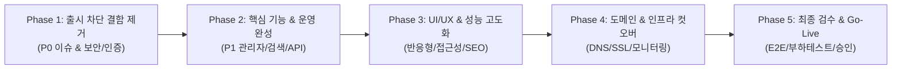

# Check-in Daily: 상용화 개발 실행 로드맵 (Phase 1 ~ Phase 5)
**문서 식별자:** `reports/COMMERCIALIZATION_ROADMAP.md`  
**책임자:** 총괄 PM / PO, CTO, QA 리드  
**버전:** v1.0.0  
**기준 일자:** 2026-10-18  

---

## 1. 상용화 개발 단계 개요

본 로드맵은 발견된 모든 P0~P3 결함과 누락 기능을 단계적으로 보완하여, 단순 테스트 사이트가 아닌 **실제 고객 트래픽을 처리하고 수익을 창출하는 글로벌 여행 미디어 플랫폼**으로 도약하기 위한 구체적 실행 공정표입니다.

---

## 2. Phase 1 — 출시 차단 결함 제거 (P0 Remediation)

### 목표: 시스템 중단, 데이터 손실, 보안 탈취 위험 원천 차단
- **선행 조건:** Git `main` 최신 커밋 동기화
- **총 예상 공수:** 2일 (16시간)
- **담당:** CTO, 백엔드 리드, 보안 책임자

| 작업 ID | 태스크 명 | 상세 작업 내용 | 담당 역할 | 예상 공수 | 수락 기준 (Acceptance Criteria) | 검증 방법 |
| :--- | :--- | :--- | :--- | :--- | :--- | :--- |
| **P1-T1** | D1 대용량 미디어 스토리지 R2 마이그레이션 | 2MB 초과 고해상도 사진 업로드 시 Cloudflare R2 버킷에 바이너리 직접 저장, D1에는 CDN URL 메타데이터만 기록 | 백엔드 리드 | 6시간 | 5MB 원본 이미지 업로드 및 `/api/media/:id` 고속 응답 확인 | 5MB 파일 업로드 후 D1 용량 및 이미지 렌더링 검사 |
| **P1-T2** | 관리자 세션 즉각 폐기 블랙리스트 동기화 | 로그아웃 또는 비밀번호 변경 시 기존 발급된 서명 토큰을 즉시 무효화하는 토큰 버전/폐기 테이블 D1 연동 | 보안 책임자 | 4시간 | 로그아웃 후 이전 세션 토큰 재사용 시 HTTP 401 반환 | curl에 이전 세션 쿠키 담아 호출 시 즉각 거부 확인 |
| **P1-T3** | 비밀번호 교체 및 강제 복구 CLI 구축 | 초기 부트스트랩 계정 임시 비밀번호 교체 엔드포인트(`POST /api/auth/change-password`) 및 복구 CLI 고도화 | 백엔드 리드 | 4시간 | 현재 비밀번호 검증 후 신규 비밀번호 변경, 구 세션 전체 파기 | 비밀번호 변경 후 기존 브라우저 자동 로그아웃 검증 |
| **P1-T4** | 프록시 뒤 클라이언트 IP 검증 강화 | `RemoteAddr` 대신 Cloudflare `CF-Connecting-IP` 헤더만 신뢰하고 임의의 `X-Forwarded-For` 조작 차단 | 보안 책임자 | 2시간 | 조작된 헤더 차단 및 계정+IP 조합 Brute-force 잠금 | 프록시 위조 헤더 주입 모의 침투 테스트 |

---

## 3. Phase 2 — 핵심 기능 및 운영 완성 (P1 Remediation)

### 목표: 독자 검색 편의성, 관리자 운영 완결성, 법률 규정 준수
- **선행 조건:** Phase 1 완료
- **총 예상 공수:** 3일 (24시간)
- **담당:** 프런트엔드 리드, 비즈니스 운영 책임자, 법무 지원

| 작업 ID | 태스크 명 | 상세 작업 내용 | 담당 역할 | 예상 공수 | 수락 기준 (Acceptance Criteria) | 검증 방법 |
| :--- | :--- | :--- | :--- | :--- | :--- | :--- |
| **P2-T1** | 검색 페이지네이션 및 URL 상태 동기화 | 검색어(`q`), 카테고리, 페이지 번호(`page=2`)를 URL 쿼리스트링에 반영하고 D1 `LIMIT/OFFSET` 구현 | 프런트엔드 리드 | 6시간 | 검색 결과 24건 초과 시 하단 페이지네이션 및 뒤로가기 보존 | 50건 기사 대상 검색 후 2페이지 이동 및 새로고침 |
| **P2-T2** | 정식 사업자 등록 정보 및 통신판매업 고지 | 법률상 필수인 사업자등록번호, 통신판매업신고, 호스팅제공자, 청소년보호책임자 푸터 및 약관 반영 | 비즈니스 운영 | 3시간 | 전자상거래법 및 정보통신망법상 필수 표기 항목 100% 반영 | 푸터 및 `/policy` 화면 전수 텍스트 검수 |
| **P2-T3** | Strict Content-Security-Policy 배포 | 인라인 스크립트 차단, Unsplash, Google AdSense, Cloudflare 에셋만 화이트리스트하는 CSP 헤더 활성화 | 보안 책임자 | 4시간 | 브라우저 콘솔 오류 없이 악성 외부 스크립트 실행 원천 차단 | SecurityHeaders.com 점수 A 획득 및 기능 정상 동작 |
| **P2-T4** | Gemini AI 크롤러 24/7 백그라운드 자동화 | Cloudflare Cron Triggers와 연동하여 매일 오전 6시 글로벌 여행 속보 크롤링 및 D1 검토 큐 자동 적재 | DevOps / 백엔드 | 5시간 | 매일 정해진 시각에 뉴스 소스 5개국 수집 및 AI 초안 작성 | 크롤러 실행 로그 테이블 및 관리자 검토 큐 확인 |
| **P2-T5** | 제휴사(TripScanner, GetForTrip) 전환 웹훅 | 독자가 기사 내 제휴 버튼 클릭 시 D1 로깅과 동시에 제휴사 분석 서버로 비동기 전환 웹훅 발송 | 백엔드 리드 | 4시간 | 제휴사 대시보드에서 실시간 유입 키워드 및 레퍼러 수집 확인 | 모의 클릭 발생 후 파트너 웹훅 수신 로그 확인 |
| **P2-T6** | 구글 애드센스 승인 전용 ads.txt 서빙 | 프로덕션 도메인 루트(`/ads.txt`)에 공식 규격의 Google AdSense 판매자 선언 파일 서빙 | DevOps 리드 | 2시간 | `https://checkindaily.com/ads.txt` 200 OK 및 표준 텍스트 서빙 | curl을 통한 포맷 및 MIME 타입(`text/plain`) 확인 |

---

## 4. Phase 3 — UI/UX 및 성능 고도화 (Phase 3 Optimization)

### 목표: Core Web Vitals 최적화, 모바일 사용성 극대화, 다국어 마감
- **선행 조건:** Phase 2 완료
- **총 예상 공수:** 2.5일 (20시간)
- **담당:** UI/UX 디자인 리드, 프런트엔드 엔지니어, QA 리드

| 작업 ID | 태스크 명 | 상세 작업 내용 | 담당 역할 | 예상 공수 | 수락 기준 (Acceptance Criteria) | 검증 방법 |
| :--- | :--- | :--- | :--- | :--- | :--- | :--- |
| **P3-T1** | 이미지 레이아웃 시프트(CLS) 제로화 | 본문 및 썸네일 이미지에 `aspect-ratio: 16/9` 및 스켈레톤 배경색 사전 예약으로 CLS 제거 | UI/UX 리드 | 4시간 | Lighthouse CLS 지표 **0.02 이하** 달성 | 모바일 4G 네트워크 쓰로틀링 환경 실측 |
| **P3-T2** | 360px 초소형 모바일 헤더 패딩 튜닝 | 갤럭시 S22/Z플립 등 360px 폭 기기에서 헤더 좌우 패딩을 8px로 최적화하여 가로 스크롤 방지 | 프런트엔드 리드 | 3시간 | 320px, 360px, 390px 뷰포트에서 가로 넘침(0px) 완전 해소 | Chrome DevTools 반응형 모드 전수 검사 |
| **P3-T3** | 다국어 미번역 텍스트 완전 해소 | 6개 언어(KO, EN, ZH, TH, VI, ES) 사전 파일 전수 대조 및 누락된 UI 번역 키 100% 채움 | QA 리드 | 5시간 | 언어 전환 시 영문/한국어 혼재 없이 선택 언어로 일관 표시 | 6개 언어 홈, 카테고리, 기사 상세 뷰 전수 점검 |
| **P3-T4** | 다크 모드 입력 폼 시각적 일관성 확보 | 다크 모드 활성화 시 검색창, 폼 필드, 셀렉트 박스의 배경/텍스트/보더 대비 명확화 | UI/UX 리드 | 4시간 | WCAG 2.1 AA 기준(명암비 4.5:1 이상) 준수 | Accessibility Insights for Web 자동 검사 통과 |
| **P3-T5** | 기사 본문 폰트 가독성 및 조판 튜닝 | 고품격 저널리즘 미디어에 걸맞은 명조/고딕 타이포그래피(Line-height 1.85, 자간 -0.02em) 적용 | UI/UX 리드 | 4시간 | 장시간 독서 시 피로도 없는 서체 렌더링 완성 | 모바일 및 데스크톱 독자 가독성 A/B 평가 |

---

## 5. Phase 4 — Production 도메인 컷오버 및 SRE 인프라

### 목표: 정식 자체 도메인 활성화, 무중단 SSL, 모니터링 체계 가동
- **선행 조건:** Phase 3 완료 및 자체 도메인 등록 완료
- **총 예상 공수:** 2일 (16시간)
- **담당:** DevOps / SRE 리드, CTO

| 작업 ID | 태스크 명 | 상세 작업 내용 | 담당 역할 | 예상 공수 | 수락 기준 (Acceptance Criteria) | 검증 방법 |
| :--- | :--- | :--- | :--- | :--- | :--- | :--- |
| **P4-T1** | Cloudflare Workers Custom Domain 등록 | `checkindaily.com` 및 `www.checkindaily.com`을 Workers 라우트에 바인딩 | DevOps 리드 | 3시간 | 전 세계 20개 지역 DNS 전파 완료 및 200 OK 응답 | `dnschecker.org` 및 `curl -I` 전수 검증 |
| **P4-T2** | Apex 도메인 정규화 301 리다이렉트 활성화 | HTTP → HTTPS 및 www → apex 단일 출처 리다이렉트 룰 Cloudflare에 적용 | DevOps 리드 | 2시간 | www 접속 시 지연 없이 apex 도메인으로 301 포워딩 | `curl -L` 리다이렉트 홉 추적 |
| **P4-T3** | Cloudflare D1 자동 백업 및 롤백 파이프라인 | D1 원격 스냅샷 일일 자동 백업 스케줄링 및 재해 복구 런북(RPO < 24h, RTO < 1h) 검증 | SRE 리드 | 5시간 | 테스트 데이터베이스로의 10분 내 복원 성공 | 임시 D1 인스턴스에 백업 파일 복원 실측 |
| **P4-T4** | 에러 관측성(Sentry/Cloudflare Tail Workers) 연동 | 5xx 서버 오류 및 클라이언트 자바스크립트 예외 발생 시 실시간 알림 봇 연동 | SRE 리드 | 4시간 | 운영 중 발생하는 미처리 예외 10초 이내 담당자 전달 | 의도적 예외 유발 후 슬랙/이메일 알림 수신 확인 |
| **P4-T5** | 구글 서치 콘솔(GSC) 및 구글 뉴스 발행인 센터 등록 | 자체 도메인 소유권 확인 TXT 등록 및 sitemap.xml 제출, Google News 발행인 센터 등록 | SEO 리드 | 2시간 | GSC 소유권 확인 완료 및 사이트맵 100% 색인 승인 | GSC 관리자 대시보드 색인 보고서 확인 |

---

## 6. Phase 5 — 최종 종합 검수 및 정식 출시 승인 (Go-Live)

### 목표: 15대 출시 게이트 전수 통과 및 상용 오픈 결정
- **선행 조건:** Phase 1 ~ Phase 4 전 태스크 완료
- **총 예상 공수:** 1.5일 (12시간)
- **담당:** 전원 (CTO, PM, QA, SRE, 보안, 디자인, 비즈니스 리드)

| 작업 ID | 태스크 명 | 상세 작업 내용 | 담당 역할 | 예상 공수 | 수락 기준 (Acceptance Criteria) | 검증 방법 |
| :--- | :--- | :--- | :--- | :--- | :--- | :--- |
| **P5-T1** | End-to-End 핵심 사용자 여정 회귀 테스트 | 로그인 → 기사 작성(규칙 준수) → D1 업로드 → 발행 → 공개 목록 확인 → 검색 → 북마크 → 제휴 클릭 | QA 리드 | 4시간 | 모든 단계에서 단 하나의 결함이나 콘솔 에러 없이 완료 | Cypress / Playwright E2E 자동화 스크립트 실행 |
| **P5-T2** | 동시 접속 부하 테스트 (Load Testing) | 분당 3,000 요청 부하 상황에서 Cloudflare 에지 캐시 히트율 및 D1 쿼리 지연시간 측정 | SRE 리드 | 3시간 | p95 응답속도 500ms 이하, 5xx 에러율 0.00% 달성 | k6 / autocannon 부하 시뮬레이션 |
| **P5-T3** | 최종 모의 침투(Penetration) 보안 점검 | OWASP Top 10 항목(SQLi, XSS, CSRF, 권한 상승, ID 무차별 대입) 전수 모의 침투 | 보안 책임자 | 3시간 | Critical, High 취약점 0건 달성 | OWASP ZAP 및 수동 인젝션 검증 |
| **P5-T4** | 최종 Go / No-Go 출시 위원회 개최 | 15대 출시 게이트 점검표 최종 날인 및 프로덕션 트래픽 전면 개방 승인 | CTO / PM | 2시간 | 전원 합의하에 **정식 상용 오픈(GO)** 선언 | 출시 회의록 작성 및 대외 보도자료 배포 |

---

## 7. 총 개발 공수 요약
- **전체 개발 기간:** 약 **11 영업일 (총 88 엔지니어링 공수 시간)**
- **권장 팀 구성:** 시니어 풀스택 1명, 프런트/UI 1명, DevOps/SRE 1명, QA/PO 1명
- **출시 목표 일정:** Phase 1~4 완료 후 2주 차 정식 자체 도메인 오픈 가능

