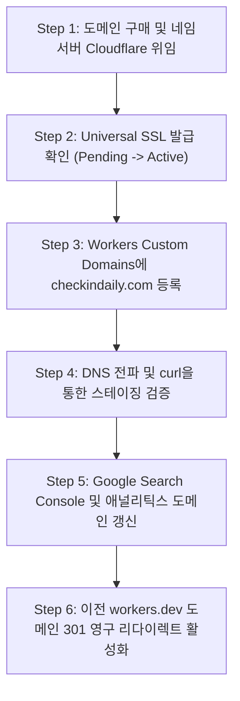

# Check-in Daily: 자체 도메인 정식 출시 및 Production 인프라 연동 가이드
**문서 식별자:** `reports/DOMAIN_PRODUCTION_READINESS.md`  
**책임자:** DevOps / SRE 리드, 보안 책임자, CTO  
**버전:** v1.0.0 (Release Candidate)  
**대상 시스템:** Cloudflare Workers, Cloudflare D1 (`checkin-daily-db`), Nuxt 4 Nitro SSR  

---

## 1. 개요 및 현재 도메인 현황 분석

체크인데일리(Check-in Daily)는 현재 Cloudflare Workers 기본 서브도메인에서 실시간 프로덕션 빌드가 안정적으로 구동되고 있습니다.

- **현재 활성 개발/스테이징 URL:** `https://travel-checkin-daily.dnjstjqppk.workers.dev`
- **목표 상용 프로덕션 도메인:** `https://checkindaily.com` (또는 구매 예정인 자체 등록 도메인)
- **보조 서브도메인:** `www.checkindaily.com`, `admin.checkindaily.com`(선택적 분리), `api.checkindaily.com`(선택적 분리)

상용 미디어 플랫폼으로서 신뢰성, 브랜드 가치, 그리고 **구글 뉴스(Google News Publisher Center)** 승인을 획득하기 위해서는 `workers.dev` 도메인에서 벗어나 자체 보유 도메인으로의 완전한 인프라 컷오버(Cutover)가 필수적입니다.

---

## 2. DNS 아키텍처 및 레코드 설정 가이드

Cloudflare DNS 관리자 콘솔에서 설정해야 하는 필수 DNS 레코드 매핑 기준입니다.

| Type | Name | Content / Target | Proxy Status | TTL | 역할 및 비고 |
| :--- | :--- | :--- | :--- | :--- | :--- |
| **CNAME** | `@` (apex) | `travel-checkin-daily.dnjstjqppk.workers.dev` | **Proxied (Orange Cloud)** | Auto | 루트 apex 도메인을 Cloudflare Worker로 프록시 라우팅 |
| **CNAME** | `www` | `checkindaily.com` | **Proxied (Orange Cloud)** | Auto | www 트래픽을 apex 도메인으로 CNAME 매핑 |
| **TXT** | `@` | `v=spf1 include:_spf.google.com ~all` | DNS Only | Auto | 편집국 공식 이메일 위조 방지 SPF 레코드 |
| **TXT** | `_dmarc` | `v=DMARC1; p=quarantine; rua=mailto:dmarc@checkindaily.com` | DNS Only | Auto | 피싱 및 메일 스푸핑 방지 DMARC 레코드 |
| **TXT** | `@` | `google-site-verification=...` | DNS Only | Auto | Google Search Console 및 Google News 인증용 토큰 |

> **[중요 원칙]**  
> Cloudflare Workers Custom Domains 기능을 사용할 경우, Cloudflare 대시보드의 **Workers & Pages > travel-checkin-daily > Settings > Domains & Routes** 메뉴에서 `checkindaily.com`을 등록하면 CNAME 레코드 및 Universal SSL 인증서가 자동으로 무중단 프로비저닝됩니다.

---

## 3. 도메인 정규화 및 www / apex 리다이렉션 정책

### 3.1 공식 표준 정책: Apex Canonical (`https://checkindaily.com`)
검색 엔진 최적화(SEO)에서 검색 크롤러의 도메인 점수(Domain Authority) 분산을 방지하기 위해 다음 규칙을 강제합니다:

1. **`http://checkindaily.com`** → `301 Moved Permanently` → **`https://checkindaily.com`**
2. **`http://www.checkindaily.com`** → `301 Moved Permanently` → **`https://checkindaily.com`**
3. **`https://www.checkindaily.com`** → `301 Moved Permanently` → **`https://checkindaily.com`**

### 3.2 Cloudflare Bulk Redirects 설정 룰
Cloudflare 대시보드 **Rules > Redirect Rules**에서 아래 표현식을 등록합니다:
- **Rule Name:** `Enforce Apex Canonical`
- **When incoming requests match:** `(http.host eq "www.checkindaily.com") or (http.request.scheme eq "http")`
- **Then:** `Dynamic Redirect` to `concat("https://checkindaily.com", http.request.uri.path)` with Status code `301`.

---

## 4. SSL/TLS 암호화 및 보안 전송 계층

1. **SSL/TLS 암호화 모드:** **Full (Strict)**
   - Cloudflare 에지 ↔ 오리진 서버 간 상호 암호화 적용.
2. **최소 TLS 버전:** **TLS 1.2** (TLS 1.0, 1.1 차단).
3. **Universal SSL 인증서:** Cloudflare 발급 ECDSA (SHA-256) 인증서 사용.
4. **HSTS (HTTP Strict Transport Security):**
   - `max-age=31536000; includeSubDomains; preload`
   - 브라우저가 최초 1회 접속 후 절대 비암호화 HTTP로 접속하지 못하도록 강제.

---

## 5. 쿠키(Cookie) 및 세션 스코프 아키텍처

체크인데일리의 관리자 세션 쿠키(`checkin_admin_session`)는 자체 도메인 적용 시 아래 보안 속성을 반드시 준수해야 합니다.

```http
Set-Cookie: checkin_admin_session=<hmac-signed-token>; 
  Path=/; 
  Domain=checkindaily.com; 
  Max-Age=28800; 
  HttpOnly; 
  Secure; 
  SameSite=Strict
```

- **Domain:** 서브도메인 분리 여부에 따라 명시적 도메인 바인딩.
- **HttpOnly:** 자바스크립트(`document.cookie`)의 접근을 100% 차단하여 XSS 기반 토큰 탈취 방지.
- **Secure:** HTTPS 통신에서만 쿠키 전송 허용.
- **SameSite=Strict:** 외부 사이트 링크를 통한 CSRF 공격 원천 차단.

---

## 6. CORS 및 API 서브도메인 정책

Go 백엔드(`CORS_ALLOWED_ORIGINS`) 및 Nuxt Nitro 서버의 허용 오리진 화이트리스트는 아래와 같이 단일 출처로 동기화됩니다:

```bash
# 프로덕션 운영 환경변수
CORS_ALLOWED_ORIGINS="https://checkindaily.com,https://www.checkindaily.com"
```

- 와일드카드(`*`) 사용 절대 금지.
- 자격증명(`Access-Control-Allow-Credentials: true`) 전송 시 특정 Origin만 명시적 반환.
- `Vary: Origin` 헤더를 포함하여 CDN 캐시 오염 방지.

---

## 7. 스테이징(Staging)과 프로덕션(Production) 환경 격리

데이터베이스와 인증 정보의 오염을 방지하기 위해 엄격한 환경 분리를 적용합니다:

| 구분 | 도메인 | D1 데이터베이스 | 세션 시크릿 | 배포 트리거 |
| :--- | :--- | :--- | :--- | :--- |
| **Development** | `localhost:3000` | SQLite 로컬 파일 (`.db`) | `dev-session-secret...` | 로컬 `npm run dev` |
| **Staging** | `staging.checkindaily.workers.dev` | `checkin-daily-staging-db` | Staging KMS Secret | GitHub PR 머지 시 자동 배포 |
| **Production** | `checkindaily.com` | `checkin-daily-db` (D1 APAC) | Production KMS Secret | `main` 브랜치 태그 릴리스 |

---

## 8. 무중단 컷오버 런북 (Zero-Downtime Cutover Runbook)

정식 도메인 연결 시 서비스 중단 없이 안전하게 전환하기 위한 단계별 실행 절차입니다:



### 8.1 세부 실행 단계
1. **[D-Day -3]** 도메인 등록 기관(GoDaddy, Namecheap 등)에서 네임서버를 Cloudflare 지정 네임서버로 변경.
2. **[D-Day -1]** Cloudflare SSL 상태가 `Active`로 전환되었는지 확인.
3. **[D-Day 00:00]** `wrangler.toml`에 커스텀 도메인 라우트 설정 추가:
   ```toml
   routes = [
     { pattern = "checkindaily.com/*", zone_name = "checkindaily.com" },
     { pattern = "www.checkindaily.com/*", zone_name = "checkindaily.com" }
   ]
   ```
4. **[D-Day 00:05]** `npx wrangler deploy` 실행하여 프로덕션 라우트 활성화.
5. **[D-Day 00:10]** 외부 글로벌 네트워크(`DNS Checker`)에서 20개국 DNS 전파 상태 및 HTTP 200 응답 실측.
6. **[D-Day +1]** `workers.dev` 주소로 유입되는 기존 링크는 `301 Moved Permanently`로 자체 도메인으로 포워딩.

---

## 9. 롤백 플랜 (Emergency Rollback Procedure)

만약 신규 도메인 연동 중 DNS 장애, SSL 핸드셰이크 실패 또는 예기치 않은 오류가 발생할 경우:

1. **즉각 조치 (5분 이내):**
   - Cloudflare 대시보드에서 `checkindaily.com` 커스텀 도메인 라우트를 일시 해제.
   - 기존 `travel-checkin-daily.dnjstjqppk.workers.dev` 엔드포인트를 유지하여 서비스 연속성 보장.
2. **원인 조사 및 픽스:**
   - Cloudflare Audit Logs 및 Workers Real-time Logs를 통해 SSL 인증서 체인 및 Origin 응답 검사.
3. **재시도:**
   - 로컬 스테이징 환경에서 DNS 모의 해석 검증 후 재배포.
